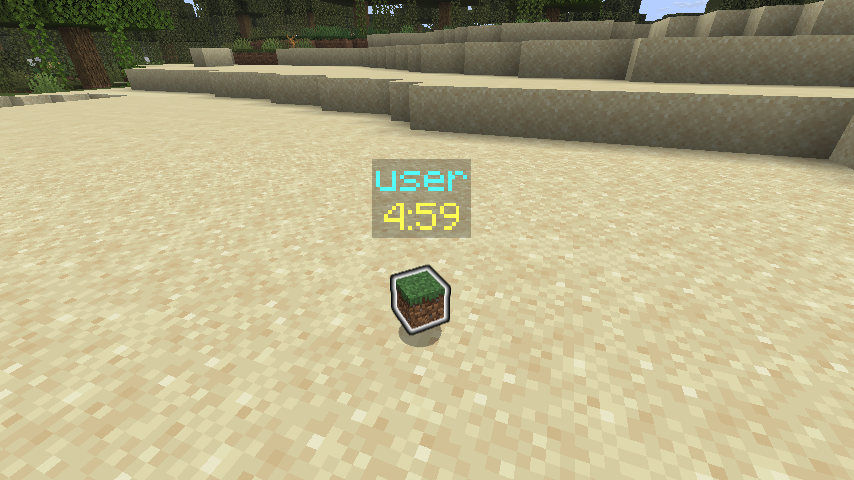

# PrivateDrop

Players can only pick up items they have dropped. Dropped items display both the time remaining before they disappear and the name of the player who dropped them.

## Installation

1. Download the jar from this page.
2. Drop it into your server's `plugins` folder.
3. Restart the server.

